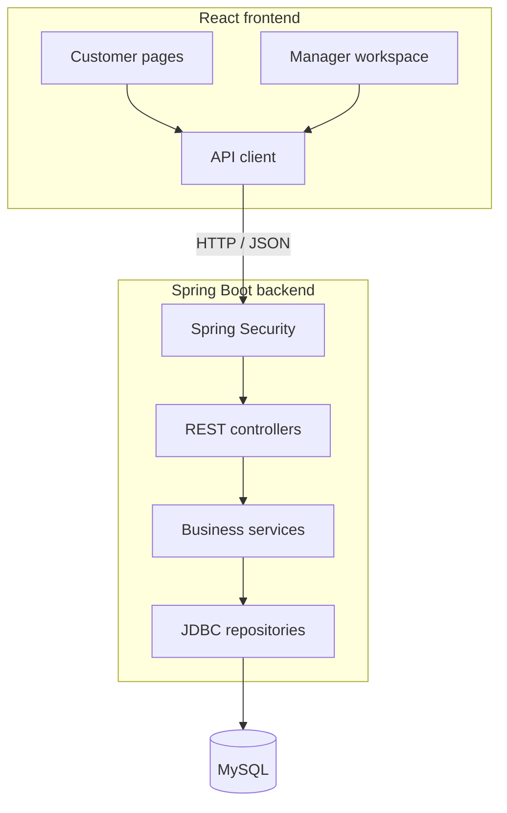
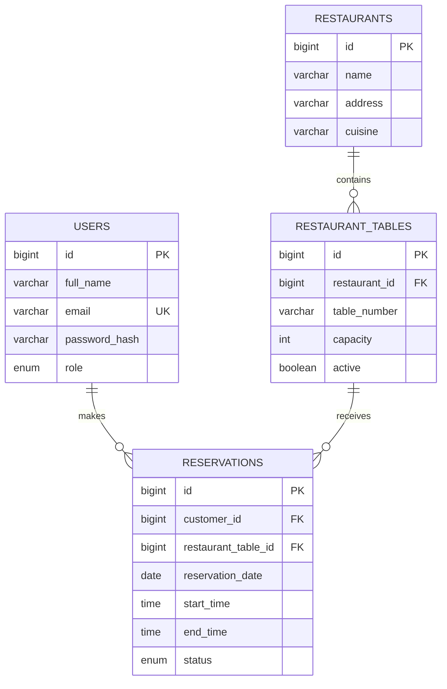

<div align="center">

# 🍽️ VIPTables

### Your table. Your time. A better dining experience.

A full-stack restaurant reservation system that brings table discovery, time-slot availability, and restaurant management into one place.


[Explore Features](#-features) · [Get Started](#-getting-started) · [Architecture](#-architecture) · [API Guide](#-api-overview)

</div>

---

## ✨ Overview

VIPTables helps customers find a restaurant, check available tables for a chosen date and time, and manage their reservations. Managers use a dedicated workspace to maintain restaurants and tables, review bookings, and track dashboard statistics.

The project combines a React interface with a Java REST API and a relational MySQL database. Booking rules and access checks live in the backend so that the same rules apply beyond the browser interface.

## 🎯 Features

| For customers | For managers |
| --- | --- |
| Register an account and sign in | Access a dedicated manager dashboard |
| Browse restaurants and view their details | Create, edit, and delete restaurants |
| Explore active tables and seating capacity | Add and edit tables and their capacity |
| Check availability for a date and time window | Deactivate tables that should no longer accept bookings |
| Reserve an available table | View reservations across the system |
| View and cancel personal reservations | Update reservation status |

### Booking rules that matter

- **Time validation:** past dates and invalid time windows are rejected.
- **Conflict checks:** overlapping confirmed bookings for the same table are rejected.
- **Transactional booking:** customer booking creation locks the selected active table before checking conflicts and saving.
- **Ownership checks:** customers can create, list, and cancel only their own reservations.
- **Backend role checks:** manager routes require the `MANAGER` role.
- **Reservation history protection:** deleting a restaurant with reservations is rejected; its tables can be deactivated instead.

## 🧰 Technology stack

| Layer | Technologies |
| --- | --- |
| Frontend | React 19, React Router 7, Vite 7 |
| Styling and animation | Tailwind CSS 3, Motion |
| Backend | Java 17, Spring Boot 3.5.5, Spring Web |
| Authentication | Spring Security, HTTP Basic, BCrypt password hashing |
| Persistence | Spring JDBC, MySQL Connector/J, HikariCP |
| Validation and errors | Jakarta Bean Validation, centralized exception handling |
| Testing | Spring Boot Test, Spring Security Test, MockMvc, Mockito |
| Build tools | Maven, npm |

## 🏗️ Architecture



The frontend handles navigation, forms, and feedback. Controllers expose the API, services enforce booking and ownership rules, and JDBC repositories execute database queries.

### Data model



Reservations use two statuses: `CONFIRMED` and `CANCELLED`. Table numbers are unique within each restaurant, and foreign keys link bookings to customers and tables.

## 🚀 Getting started

### Prerequisites

- Java 17 and Maven
- Node.js 20.19+ or 22.12+ and npm, compatible with Vite 7
- A running MySQL server; MySQL 8+ is recommended for the supplied schema
- Git

### 1. Clone the repository

```bash
git clone https://github.com/harsha160507/VIP-Tables-reservation.git
cd VIP-Tables-reservation
```

### 2. Initialize the database

Run this from the repository root, using your MySQL account:

```bash
mysql -u YOUR_MYSQL_USER -p < database/schema.sql
```

The script creates the `viptables` database, its tables, development accounts, and two sample restaurants. It does **not** create sample restaurant tables—add those through the manager workspace before trying a customer booking.

> Database initialization is manual: the backend configuration sets `spring.sql.init.mode` to `never`. Run the schema once on a fresh development database; rerunning its restaurant inserts can add duplicate sample restaurants.

### 3. Start the backend

In a Bash-compatible terminal, set your database connection details:

```bash
export DB_URL='jdbc:mysql://localhost:3306/viptables?serverTimezone=UTC'
export DB_USERNAME='YOUR_MYSQL_USER'
read -rsp 'MySQL password: ' DB_PASSWORD
export DB_PASSWORD
echo

cd backend
mvn spring-boot:run
```

You can also set these environment variables in your IDE's run configuration.

The API starts at **http://localhost:8080** by default.

### 4. Start the frontend

Open another terminal from the repository root:

```bash
cd frontend
npm ci
npm run dev
```

Open **http://localhost:5173**. Vite forwards `/api` requests to the backend on port `8080`.

### ⚙️ Configuration reference

| Variable | Purpose | Default |
| --- | --- | --- |
| `DB_URL` | MySQL JDBC connection URL | Local `viptables` database on port `3306`, with database creation enabled and UTC server timezone |
| `DB_USERNAME` | MySQL username | `root` |
| `DB_PASSWORD` | MySQL password | Required; no default |
| `DB_MAX_POOL_SIZE` | Maximum database connections | `10` |
| `DB_MIN_IDLE` | Minimum idle database connections | `2` |
| `PORT` | Backend HTTP port | `8080` |
| `VITE_API_BASE_URL` | Optional frontend API origin | Empty; requests use the current origin |

If you change the backend port, update the development proxy in [frontend/vite.config.js](frontend/vite.config.js). A separate API origin also requires appropriate server-side CORS configuration.

## 🔑 Try the application

Register a customer account through the application. For the manager workflow, use a manager account configured in your local development database. The schema includes development seed data; review it before running it outside a local environment.

New registrations create customer accounts.

1. Sign in as the manager and open the table management page.
2. Select one of the sample restaurants and add a table with a number and capacity.
3. Sign out and sign in as the customer, or register a new account.
4. Open a restaurant, choose a date and time window, and check availability.
5. Reserve an available table and review it in your reservations.
6. Cancel the booking, then check the manager reservation view.

> Replace or remove development seed accounts before deployment. The current application uses HTTP Basic authentication and stores its authorization value in browser session storage; use HTTPS and review credential handling before a public deployment.

## 📡 API overview

All paths below are relative to the backend origin. Protected requests use HTTP Basic authentication with the user's email and password.

### Public and account endpoints

| Method | Endpoint | Purpose |
| --- | --- | --- |
| `GET` | `/api/health` | Application/database health response |
| `GET` | `/api/restaurants` | List restaurants |
| `GET` | `/api/restaurants/{id}` | View a restaurant |
| `GET` | `/api/restaurants/{restaurantId}/tables` | List active tables |
| `GET` | `/api/restaurants/{restaurantId}/availability` | Check tables using `date`, `startTime`, and `endTime` query parameters |
| `POST` | `/api/auth/register` | Register a customer |
| `GET` | `/api/auth/me` | Get the authenticated user's profile; authentication required |

### Reservation endpoints

| Method | Endpoint | Purpose |
| --- | --- | --- |
| `POST` | `/api/reservations` | Create a reservation for the authenticated customer |
| `GET` | `/api/reservations?customerId={id}` | List the customer's own reservations |
| `GET` | `/api/reservations/{id}` | View a reservation as its owner or a manager |
| `PATCH` | `/api/reservations/{id}/cancel?customerId={id}` | Cancel the customer's own booking |

### Manager endpoints

Every endpoint in this group requires the `MANAGER` role.

| Method | Endpoint | Purpose |
| --- | --- | --- |
| `GET` | `/api/manager/dashboard` | View summary statistics |
| `GET / POST` | `/api/manager/restaurants` | List or create restaurants |
| `PUT / DELETE` | `/api/manager/restaurants/{id}` | Update or delete a restaurant |
| `GET / POST` | `/api/manager/restaurants/{restaurantId}/tables` | List or create tables |
| `PUT` | `/api/manager/tables/{id}` | Update a table |
| `PATCH` | `/api/manager/tables/{id}/deactivate` | Deactivate a table |
| `GET` | `/api/manager/reservations` | List all reservations |
| `PATCH` | `/api/manager/reservations/{id}/status` | Set `CONFIRMED` or `CANCELLED` |

### Quick API checks

```bash
curl http://localhost:8080/api/health

curl --user 'YOUR_ACCOUNT_EMAIL' http://localhost:8080/api/auth/me
```

## 📂 Project guide

| Location | Contents |
| --- | --- |
| [frontend/src/pages](frontend/src/pages) | Customer pages and manager screens |
| [frontend/src/components](frontend/src/components) | Shared layout, route protection, and UI components |
| [frontend/src/context](frontend/src/context) | Authentication state |
| [frontend/src/services/api.js](frontend/src/services/api.js) | Frontend API requests |
| [backend/src/main/java/com/viptables/controller](backend/src/main/java/com/viptables/controller) | REST endpoints |
| [backend/src/main/java/com/viptables/service](backend/src/main/java/com/viptables/service) | Booking, availability, and management rules |
| [backend/src/main/java/com/viptables/repository](backend/src/main/java/com/viptables/repository) | JDBC queries and persistence |
| [backend/src/main/java/com/viptables/model](backend/src/main/java/com/viptables/model) | Domain records and enums |
| [backend/src/main/java/com/viptables/dto](backend/src/main/java/com/viptables/dto) | Request and response types |
| [backend/src/main/java/com/viptables/config](backend/src/main/java/com/viptables/config) | Security and database configuration |
| [backend/src/main/java/com/viptables/exception](backend/src/main/java/com/viptables/exception) | Centralized API error handling |
| [backend/src/test](backend/src/test) | Backend tests |
| [database/schema.sql](database/schema.sql) | MySQL schema and development seed data |

## 🧪 Tests and builds

Run the backend test suite from `backend/`:

```bash
mvn test
```

The included manager authorization tests cover unauthenticated access, customer rejection, manager access, and the absence of a browser Basic-auth challenge for an unauthenticated manager dashboard request. These are MVC tests with mocked collaborators, rather than end-to-end database tests.

Build the backend:

```bash
mvn clean package
```

Build the frontend from `frontend/`:

```bash
npm run build
npm run preview
```

The preview command serves the frontend build locally; it is not a complete deployment setup. Configure API routing for production separately.

---

<div align="center">

**Discover a restaurant. Choose your table. Make it a reservation.**

</div>
